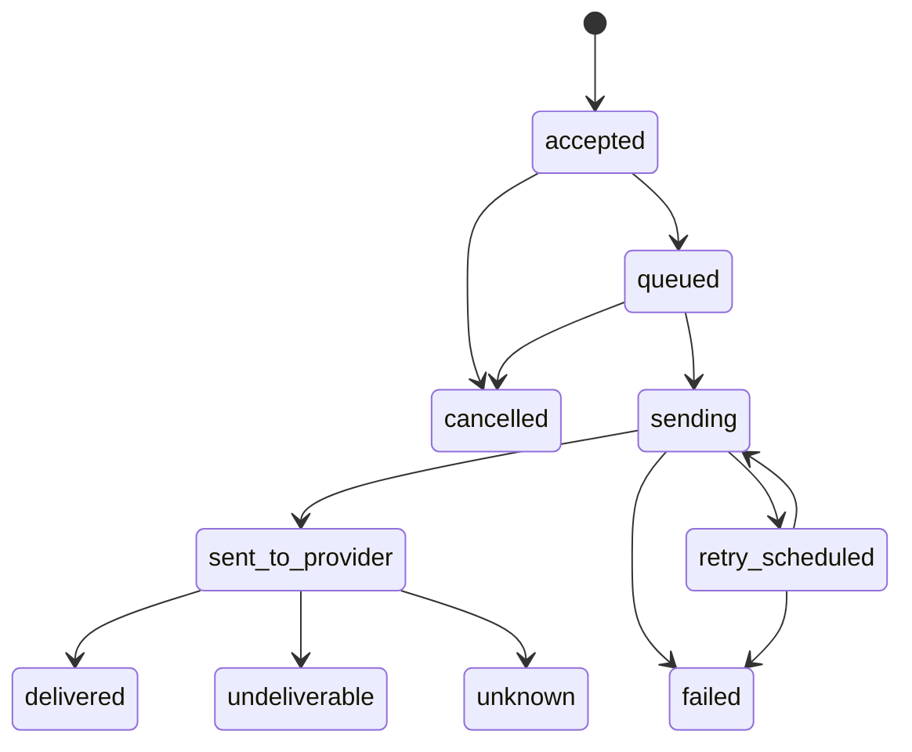

# ADR-0008 — Bildirim durum makinesi ve kontör defteri

**Durum:** Önerildi · **Faz:** PHASE-00 (uygulama PHASE-05/06/07)

## Bildirim durumları

- `sent_to_provider` (SMTP kabulü, SMS API 2xx) **teslimat kanıtı değildir**. `delivered`/`undeliverable` yalnızca
  imzası doğrulanmış provider callback'i veya bakiye/DLR sorgusuyla oluşur.
- Durum geçişleri tek bir `NotificationStateMachine` içinde, `version` alanıyla optimistic locking ile yapılır;
  geriye geçiş reddedilir. Callback tekrarları `(provider, provider_message_id, event_type)` tekil kısıtıyla idempotenttir.
- Hata sınıfı: `transient` (retry) / `permanent` (DLQ değil, `failed`) / `unknown` (sınırlı retry, sonra DLQ).
- Fallback'te ikinci sağlayıcıya geçmeden önce ilkinin durumu `unknown` ise çift gönderim riski kullanıcı politikasına bağlıdır
  (varsayılan: fallback yapma).

## Kontör kavramları (birbirine karıştırılmaz)
1. **Provider gerçek bakiyesi** — provider API'sinden periyodik senkron, salt-okunur gözlem.
2. **Yerel tahmini bakiye** — defterden hesaplanan.
3. **Platform kotası** — AIH'nin tenant/proje başına koyduğu limit (ticari plan).

## Defter
- `credit_ledger_entries` **append-only**: `id, tenant_id, project_id, account, entry_type, amount_minor, currency,
  reference_type, reference_id, idempotency_key, created_at, created_by`. UPDATE/DELETE DB yetkisiyle engellenir.
- Bakiye = SUM; okuma için periyodik snapshot tablosu. Rezervasyon → kesinleştirme/iade çift kayıt ile.
- `(tenant_id, idempotency_key)` tekil; eşzamanlılık `SELECT … FOR UPDATE` bakiye satırı veya serializable transaction ile.
- Manuel ekleme dört-göz onayı ister ve **provider'da yükleme değildir**. Provider top-up yalnızca resmi API desteği varsa.
