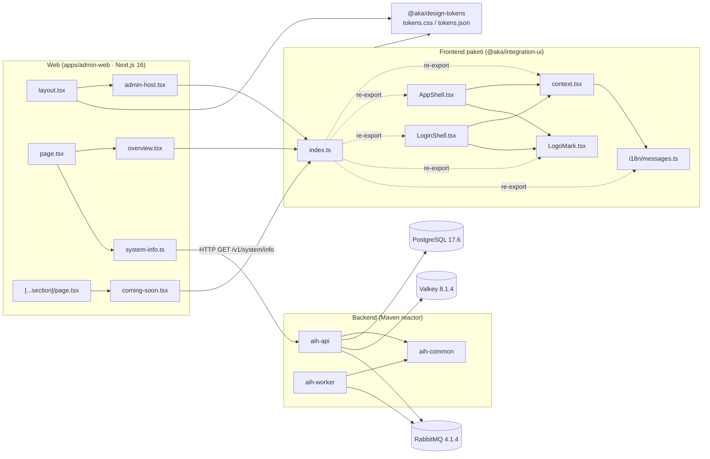
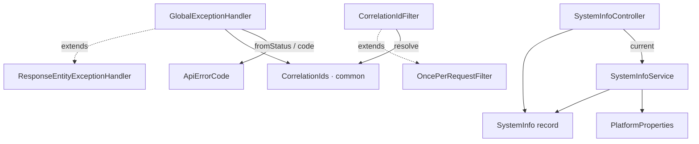
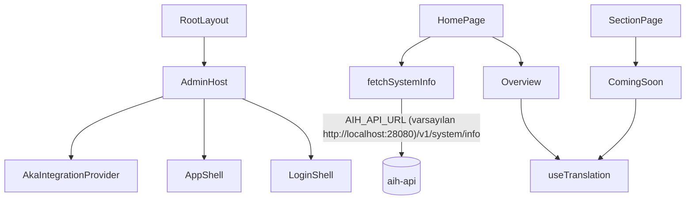

# Graphify Kod Grafiği ve Bağımlılık Analizi Raporu

**Tarih:** 2026-10-26 · **İncelenen sürüm:** `main` @ `bd29e5c` (PR #29 — PHASE-01 Foundation sonrası)
**Araç:** Graphify (`graphifyy` 0.9.95, Apache-2.0) — yalnızca AST tabanlı kod çıkarımı (`graphify update`, LLM kullanılmadı)
**Kapsam kuralı:** Mevcut kodlara hiçbir değişiklik yapılmadı. Grafik, deponun geçici bir kopyası üzerinde üretildi; bu rapor depoya eklenen tek dosyadır.

---

## 1. Özet

| Başlık | Sonuç |
|---|---|
| Graphify entegrasyonu | **Yok.** Depoda Graphify yapılandırması, `graphify-out/` çıktısı, `.graphifyignore`, CI adımı, git hook'u veya AGENTS/START_HERE içinde Graphify talimatı bulunmuyor. |
| Grafik boyutu | 90 dosya, ~15.500 kelime → **733 düğüm, 922 kenar, 55 topluluk** |
| Kenarların güvenilirliği | %100 `EXTRACTED` (doğrudan koddan); yalnız 4 kenar `INFERRED` (doküman → kod referansı) |
| Döngüsel bağımlılık (import cycle) | **Yok** |
| Backend | Java 21 / Spring Boot 4.1.1 Maven reactor: `aih-api`, `aih-worker` → `aih-common` |
| Frontend (paketler) | `@aka/integration-ui` (React 19) → `@aka/design-tokens` |
| Web | `@aka/admin-web` (Next.js 16.4.1) → `@aka/integration-ui` + `@aka/design-tokens`; API'ye HTTP ile bağlı |
| Mobil | **Henüz yok.** Mobil uygulama, React Native/Flutter/iOS/Android kodu veya bağımlılığı bulunmuyor; yalnız PHASES.md'de "web push/mobile push" kanalı planlanmış. |

Proje PHASE-01 iskelet aşamasında olduğu için grafik küçük ve katmanlar arası bağımlılıklar temiz. Mimari kararlarla (ADR-0001, ADR-0009) uyumsuzluk tespit edilmedi.

---

## 2. Graphify Entegrasyon Kontrolü

Kontrol edilenler ve sonuçları:

- `graphify` / `graphifyy` geçen dosya: **yok** (tüm depo tarandı, `.git` hariç).
- `graphify-out/` (graph.json, GRAPH_REPORT.md, graph.html): **yok**.
- `.graphifyignore`: **yok**.
- `.github/workflows/ci.yml`: Graphify adımı **yok** (backend, web, docs işleri var).
- `.gitignore`: `graphify-out/` girdisi **yok** (bugün gerek de yok, çünkü çıktı üretilmiyor).
- AGENTS.md / START_HERE.md / MASTER_PROMPT.md: Graphify talimatı **yok**.

Bu rapordaki grafik, Graphify geçici bir Python sanal ortamına kurularak ve depo kopyası üzerinde `graphify update <kopya>` çalıştırılarak üretildi.

**Graphify'ın bu çalıştırmadaki sınırları:**

- `V202610151200__create_platform_schema.sql` grafiğe girmedi (`tree_sitter_sql` kurulu değildi; `graphifyy[sql]` ekstrası gerekir).
- `Makefile`, `globals.css`, `styles.css`, `.env.example`, `.gitignore` sınıflandırılmadı.
- `pom.xml` dosyalarından sembol çıkmadı; yalnız modüller arası `depends_on` kenarları üretildi.
- `packages/ui-react/src/index.ts` sembol üretmez ama `re_exports` kenarlarıyla doğru temsil edildi.
- Markdown dokümanları yalnız başlık yapısıyla grafiğe girdi; anlamsal (LLM) çıkarım yapılmadı.

---

## 3. Genel Bağımlılık Grafiği



---

## 4. Backend Analizi (Java 21 · Spring Boot 4.1.1)

### 4.1 Modül grafiği

| Modül | Bağımlı olduğu iç modül | Ana dış bağımlılıklar |
|---|---|---|
| `aih-common` (`modules/common`) | — | `slf4j-api` |
| `aih-api` (`apps/api`) | `aih-common` | webmvc, actuator, validation, data-jpa, flyway (+ postgresql), data-redis, amqp, postgresql (runtime); test: testcontainers (postgresql, rabbitmq) |
| `aih-worker` (`apps/worker`) | `aih-common` | webmvc, actuator, amqp; test: testcontainers (rabbitmq) |

Bağımlılık yönü tek yönlü: uygulamalar → `common`. `common` hiçbir uygulamaya bağımlı değil. `api` ile `worker` arasında doğrudan kod bağımlılığı yok (ADR-0001 "modüler monolit + ayrı worker" ile uyumlu).

### 4.2 Sınıf düzeyi çağrı grafiği



- **En çok bağlantılı sembol (god node):** `ApiErrorCode` (16 kenar; 12 enum sabiti + `fromStatus`/`code`).
- **Köprü düğüm:** `CorrelationIds` en yüksek aradalık (betweenness 0.017) değerine sahip; `CorrelationIdFilter`, `GlobalExceptionHandler` ve `ApiHealthIntegrationTest` topluluklarını birbirine bağlıyor. `common` modülünün bugünkü tek gerçek tüketim noktası budur.
- **Worker:** yalnız `AkaIntegrationHubWorkerApplication` var; kendi iş mantığı ve `common` kullanımı henüz yok (bağımlılık POM'da tanımlı ama kodda kullanılmıyor).

### 4.3 Altyapı bağımlılıkları (yapılandırmadan)

| Servis | api | worker | Kaynak |
|---|---|---|---|
| PostgreSQL | ✓ (JPA `ddl-auto: validate`, Flyway `platform` şeması) | — | `apps/api/.../application.yml` |
| Valkey (Redis uyumlu) | ✓ (readiness grubunda) | — | aynı |
| RabbitMQ | ✓ | ✓ | her iki `application.yml` |
| Mailpit | — (yalnız `dev-mail` compose profili) | — | `infra/docker/compose.yaml` |

### 4.4 Gözlemler (değişiklik önerisi değil, bilgi amaçlı)

- `aih-api` içinde `data-jpa`, `data-redis` ve `amqp` starter'ları ekli, ancak kodda henüz entity, repository, cache veya mesaj üreticisi/tüketicisi yok; şu an yalnız sağlık kontrolü için kullanılıyorlar. Bu PHASE-01 kapsamıyla tutarlı.
- `aih-worker` için `spring-boot-starter-webmvc`, yalnız actuator yönetim portu için çekiliyor gibi görünüyor; ileride daha hafif bir seçenek değerlendirilebilir.
- Migration dosyası (`platform.installation`) Graphify'ın SQL desteği olmadığı için grafikte görünmüyor; manuel incelemede tek tablo ve singleton kısıtı var.

---

## 5. Frontend Analizi (`packages/*`)

### 5.1 `@aka/integration-ui` (React 19, ESM, `tsc` ile derleme, Vitest)

- Dış API tek giriş noktası olan `index.ts` üzerinden `re_exports` ile açılıyor (23 re-export kenarı).
- İç bağımlılık sırası: `messages.ts` ← `context.tsx` ← `AppShell.tsx` / `LoginShell.tsx` → `LogoMark.tsx`. Döngü yok.
- `useTranslation()` 11 kenarla paketin en merkezi fonksiyonu; hem paket içi bileşenler hem `admin-web` tarafından kullanılıyor.
- **ADR-0009 uyumu:** paket içinde `next/*` importu **yok**; yalnız `react` ve kendi modülleri kullanılıyor. Bileşenler host'a `AkaIntegrationProvider` adapter'ları (auth, locale, theme, navigation, tenant) ile bağlanıyor.
- Dış bağımlılık: `react`, `react-dom` (peer, `>=19 <20`), `@aka/design-tokens` (runtime).

### 5.2 `@aka/design-tokens`

- Kod içermez; `tokens.css` ve `tokens.json` dışa aktarır. Hem `integration-ui` (`package.json` bağımlılığı) hem `admin-web` (`layout.tsx` içinde CSS importu) tarafından tüketiliyor.

### 5.3 Planlanıp henüz olmayanlar

- `packages/ts-client` (ADR-0010: fetch tabanlı, bağımlılıksız TypeScript SDK; UI paketinin de bunu kullanması planlanıyor) — **yok**. Bugün UI paketi API'yi hiç çağırmıyor.

---

## 6. Web Analizi (`apps/admin-web` · Next.js 16.4.1)



- `admin-web` ince bir kabuk: iş mantığı yok, tüm UI `@aka/integration-ui` üzerinden geliyor (ADR-0009 ile uyumlu).
- `next` bağımlılığı yalnız `admin-web` içinde (`layout.tsx`, `admin-host.tsx`, `next.config.ts`); grafikte `next` düğümü web ile UI toplulukları arasında köprü olarak görünüyor, çünkü `admin-host.tsx` Next router'ını UI adapter'ına bağlıyor.
- **Backend ile tek entegrasyon noktası:** `system-info.ts` → `GET /v1/system/info` (2 sn zaman aşımı, `no-store`). Bu çağrıda `X-Correlation-Id` başlığı gönderilmiyor; API kendisi bir kimlik üretiyor.
- Kimlik doğrulama şimdilik sahte (`signIn` yalnız state değiştiriyor); gerçek akış PHASE-02'de planlı.
- Güvenlik başlıkları `next.config.ts` içinde tanımlı (`nosniff`, `Referrer-Policy`, `X-Frame-Options: DENY`).

---

## 7. Mobil Analizi

- Depoda mobil uygulama, mobil SDK veya mobil bağımlılık (React Native, Expo, Flutter, Swift/Kotlin, Gradle/Xcode projesi) **bulunmuyor**.
- PHASES.md içinde yalnız bir bildirim kanalı olarak "web push/mobile push" geçiyor; bu, mobil istemci değil, sunucu tarafı gönderim adaptörü olarak planlanmış.
- Graphify grafiğinde mobil ile ilgili düğüm veya topluluk yok.
- Mobil istemci eklendiğinde, ADR-0010'daki SDK stratejisine (OpenAPI'den üretilen istemciler) bağlanması beklenir; bugün bunun için bir ADR yok.

---

## 8. Topluluklar ve Merkezi Düğümler (Graphify çıktısından)

**En çok bağlantılı düğümler:**

1. `AKA INTEGRATION HUB — PHASES` (doküman) — 18 kenar
2. `ApiErrorCode` — 16 kenar
3. `compilerOptions` (tsconfig) — 15 kenar
4. `ApiHealthIntegrationTest` — 13 kenar
5. `MASTER_PROMPT` (doküman) — 12 kenar
6. `useTranslation()` — 11 kenar

**Kod topluluklarından öne çıkanlar:**

| Topluluk | İçerik | Uyum (cohesion) |
|---|---|---|
| Web + UI (`index.ts`) | AdminHost, RootLayout, AppShell, LoginShell, ComingSoon, context | 0.12 |
| Backend hata modeli (`GlobalExceptionHandler.java`) | ApiErrorCode ve enum sabitleri | 0.08 |
| Entegrasyon testleri | ApiHealthIntegrationTest, TestInfrastructure, WorkerHealthIntegrationTest | 0.10 |
| Altyapı (`mailpit`) | compose servisleri ve ortam değişkenleri | 0.05 |

Düşük uyum değerleri bu aşamada beklenen bir durum: kod tabanı küçük ve dosyaların çoğu yapılandırma/doküman.

**Doküman → kod bağlantıları (INFERRED):** `docs/PHASE_01_PLAN.md` içindeki "İş paketleri" bölümü `AppShell()` ve `AkaIntegrationProvider()` sembollerine referans veriyor; plan ile kod arasında izlenebilirlik var.

**Bilgi boşlukları:** 16 sembol ≤1 bağlantılı (çoğu `ApiErrorCode` enum sabitleri ve `io.akahub:aih-api` gibi POM düğümleri). Bu, eksik kod değil, enum/POM modellemesinin doğal sonucu.

---

## 9. Mimari Plan ile Karşılaştırma

AGENTS.md'deki repo taslağına göre durum:

| Planlanan | Durum |
|---|---|
| `apps/api`, `apps/worker`, `apps/admin-web` | Var (iskelet) |
| `packages/ui-react` | Var |
| `packages/ts-client` | Yok |
| `sdk/java`, `sdk/dotnet` | Yok |
| `modules/{identity,tenancy,providers,notifications,templates,credits,usage,billing,audit}` | Yok (yalnız `modules/common` var) |
| `infra`, `docs/{adr,security,licenses}` | Var |
| `docs/api`, `tests` | Yok |

---

## 10. Öneriler (uygulanmadı; onay gerektirir)

Bu rapor kapsamında hiçbir dosya değiştirilmedi. Graphify kalıcı olarak entegre edilmek istenirse sonraki adımlar şöyle olabilir:

1. `.gitignore` içine `graphify-out/` ekleyerek çıktının commit edilmesini önlemek ya da bilinçli olarak commit edilecekse merge driver'ı (`graphify merge-driver`) yapılandırmak.
2. `node_modules/`, `target/`, `.next/`, `package-lock.json` gibi gürültü kaynaklarını dışlayan bir `.graphifyignore` eklemek.
3. SQL migration'larının da grafiğe girmesi için `graphifyy[sql]` ekstrasıyla kurulum yapmak.
4. İsteğe bağlı olarak CI'a, PR başına grafik üretip artefakt olarak yükleyen ve import döngüsü çıkarsa uyaran bir iş eklemek.
5. Graphify'ı yeni bağımlılık olarak eklemeden önce LICENSE_POLICY.md ve docs/licenses/DEPENDENCY_POLICY.md gereği lisans (Apache-2.0), bakım ve CVE kaydını envantere işlemek.

---

## 11. Yeniden Üretme

```bash
python3 -m venv /tmp/graphify-venv
/tmp/graphify-venv/bin/pip install graphifyy          # SQL için: "graphifyy[sql]"
cp -r aka-integration-hub /tmp/aih-copy && rm -rf /tmp/aih-copy/.git
/tmp/graphify-venv/bin/graphify update /tmp/aih-copy  # LLM gerekmez
# Çıktı: /tmp/aih-copy/graphify-out/{graph.json,GRAPH_REPORT.md,graph.html}
```

Kopya üzerinde çalıştırmak, depo içinde `graphify-out/` oluşmasını önler.
